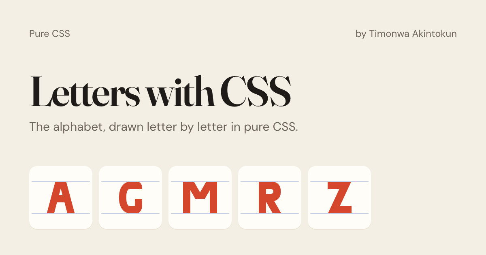

# Letters with CSS

The 26 capital letters of the English alphabet, drawn with HTML and CSS alone — no images, SVG, or fonts — with the code for every letter one click away.

[](https://letters-with-css.vercel.app) [](LICENSE)



I built this to practise four CSS techniques by drawing every letter with them: pseudo-elements, borders and box-shadow, positioning, and transforms. Each letter's code can be viewed and copied, so anyone learning those techniques can see exactly how it's made.

## View and copy a letter's code

On the [live site](https://letters-with-css.vercel.app), select any letter. A dialog shows it large, with two tabs:

- **HTML**: the markup for the letter, usually one or two elements.
- **CSS**: every rule that draws it, plus the 240×240 box it sits in and the `--ink` colour variable.

Copy both into any page and the letter renders. Change `--ink` to recolour it. Each letter also has its own link, such as [letters-with-css.vercel.app/#S](https://letters-with-css.vercel.app/#S).

The CSS tab is read from the live stylesheet, so it always matches what's drawn.

## What it practises

Every letter is one or two elements inside a 240×240 box, shaped with only these techniques:

- `::before` and `::after` pseudo-elements, for the extra strokes a single element can't make.
- Borders and `box-shadow`, for strokes, curves, and the counters inside letters like O and D.
- Relative and absolute positioning, to place each piece.
- Transforms, to rotate and skew the diagonals in letters like A, N, and W.

## Run it locally

There's no build step. Clone the repo:

```bash
git clone https://github.com/Timonwa/letters-with-css.git
cd letters-with-css
```

Then serve the folder, either way works:

- **VS Code:** open the folder, install the [Live Server](https://marketplace.visualstudio.com/items?itemName=ritwickdey.LiveServer) extension, and click **Go Live** in the status bar.
- **Terminal:** run `npx serve` and open the URL it prints.

Use a server rather than opening `index.html` directly: browsers block the code viewer from reading the stylesheet on `file://` pages.

## Project structure

| File | What it holds |
| --- | --- |
| `style.css` | The letters: every rule that draws A to Z |
| `site.css` | The page: layout, tiles, dialog, and colours |
| `app.js` | The code viewer: opens a letter and builds its HTML and CSS |
| `index.html` | The page markup, metadata, and the 26 letters |
| `og.png` | The image shown when the site is shared |

## More projects like these

- [Shapes with CSS](https://shapes-with-css.vercel.app): 26 shapes, from a circle to a magnifying glass, drawn in pure CSS ([source](https://github.com/Timonwa/shapes-with-css)).
- [JavaScript Project Series](https://javascript-project-series.vercel.app): 10+ beginner JavaScript projects, each with a step-by-step tutorial ([source](https://github.com/Timonwa/javascript-project-series)).

## Contributing

Found a letter that could be drawn more simply? Open an [issue](https://github.com/Timonwa/letters-with-css/issues) or a pull request.

## License

[MIT](LICENSE) © Timonwa Akintokun
